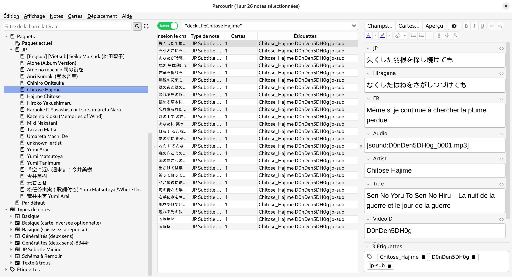

# jpsub : apprendre le japonais avec ses chansons

Écouter une chanson, comprendre chaque ligne et apprendre ses mots : la pipeline télécharge
la vidéo YouTube, transcrit les paroles (Whisper), ajoute les furigana, traduit en français (DeepL)
et prépare des cartes Anki ; l'appli web (« atelier d'étude ») sert à tout parcourir.



## Lancer

Prérequis : [uv](https://docs.astral.sh/uv/getting-started/installation/), `ffmpeg` (`sudo apt install ffmpeg`)
et, pour les cartes, [Anki](https://apps.ankiweb.net/) avec l'extension [AnkiConnect](https://ankiweb.net/shared/info/2055492159).

```bash
./start.sh           # lance Anki si besoin, puis l'appli en arrière-plan, et ouvre http://localhost:8000
./start.sh stop      # arrête l'appli (Anki reste ouvert)
./start.sh restart   # après une modification du code
./start.sh logs      # suit le journal (data/jpsub.log)
./start.sh status    # l'appli et Anki tournent-ils ?
./start.sh fg        # au premier plan, journal dans le terminal (Ctrl+C pour arrêter)
./start.sh update    # met à jour les dépendances (yt-dlp en tête) et uv.lock
```

Au premier lancement, uv installe Python 3.12 et les dépendances figées dans `uv.lock`
(dans `.venv/`), et crée `.env` à partir de `.env.example`. Les modèles Whisper sont gardés dans `data/models/`.

`./start.sh` lance Anki s'il ne répond pas déjà sur le port 8765 ; `./start.sh anki` ne lance qu'Anki,
`JPSUB_NO_ANKI=1 ./start.sh` s'en passe, `JPSUB_ANKI_CMD=…` indique où il est installé.
L'appli tourne sur la même machine qu'Anki : AnkiConnect peut écouter sur `127.0.0.1` (sa valeur par défaut).

## Configuration

`.env` (jamais commité) :

```env
DEEPL_API_KEY=…   # https://www.deepl.com/pro-api — sans clé, pas de traduction ni de sens des mots
HF_TOKEN=…        # facultatif : https://huggingface.co/settings/tokens (téléchargements de modèles plus rapides)
OPENAI_API_KEY=…  # seulement avec asr.backend: api (uv sync --extra api)
```

- `config.yaml` : modèle Whisper (`asr.model`, `small` par défaut ; `medium` est plus précis mais plus lent),
  seuils de détection de langue, découpage des sous-titres.
- `cookies/youtube-cookies.txt` (facultatif) : cookies YouTube pour les vidéos qui en demandent ;
  la pipeline travaille sur une copie, le fichier n'est jamais modifié.
- `artists_map.yaml` : corriger l'artiste d'une vidéo (`ID_YOUTUBE: Nom`) ; une vidéo listée ici est
  aussi considérée comme japonaise.

## Ce que fait l'appli

- **Bibliothèque** : toutes les chansons de `output/<artiste>/<id>/`, y compris celles produites par l'ancienne pipeline.
- **Atelier** (une page par chanson) :
  - forme d'onde cliquable, lecture, boucle sur une ligne, vitesse réduite ; clavier : espace, ← →
  - chaque ligne : japonais avec furigana, traduction française (« Cacher le français » pour s'entraîner à comprendre seul)
  - les mots à apprendre sont soulignés ; un clic ouvre leur fiche (lecture, sens, occurrences à réécouter, fréquence dans la bibliothèque)
  - lignes douteuses signalées (confiance Whisper faible, texte surtout non japonais, boucle) : on les réécoute, puis « C'est juste » retire l'alerte
  - vocabulaire de la chanson : filtres « Avec kanji » / « Nouveaux pour moi », « Je connais déjà », puis envoi des mots cochés vers Anki (AnkiConnect) ou téléchargement d'un paquet `.apkg` (mot, lecture, sens, phrase, traduction, clip audio)
- **Jobs** : coller des URL, suivre les étapes en direct, relancer une étape en échec, « Forcer le japonais » pour une vidéo rejetée.

La vidéo noire (`black_video.mp4`) n'est plus générée : l'atelier lit directement l'audio.
Les fonctions shell `playlast`, `playdir`… ci-dessous cherchent `black_video.mp4` puis `source_video.*` :
elles ne trouveront rien pour les nouvelles chansons (audio seul), utilisez l'atelier à la place.

Architecture : un seul process (API FastAPI + worker en thread + SQLite dans `data/jpsub.sqlite3`).
La table `jobs` sert de file d'attente, la base garde aussi le sens des mots et ce que vous connaissez déjà ;
les dossiers `output/` restent la source de vérité.

## Détection du japonais

Les métadonnées YouTube (titre, tags, langue déclarée) sont souvent incomplètes ou fausses.
Elles ne servent plus qu'à écarter les cas évidents (tutoriel, podcast…).
La décision vient de l'audio : Whisper écoute 3 extraits de 30 s (à 30 %, 50 % et 70 % du morceau)
et garde la meilleure probabilité « ja ». Réglages dans `config.yaml` (`language_check`).
Le résultat et sa raison sont enregistrés dans `metadata.detected.json` (clé `language`).

```bash
uv run python -m jpsub detect-lang output/Artiste/ID/audio.wav   # tester la détection
uv run python -m jpsub run --input URL --force-ja                 # forcer le traitement
```

## Ligne de commande

Sans l'appli web, la même pipeline se lance en ligne de commande (`main.py` délègue à `jpsub`) :

```bash
uv run python -m jpsub run --input "https://www.youtube.com/watch?v=VIDEO_ID"
uv run python -m jpsub run --input-file batch.txt     # une URL par ligne
```

Chaque étape est mise en cache : relancer une vidéo reprend là où elle s'était arrêtée,
et changer de modèle Whisper ou de réglages de sous-titres relance seulement les étapes concernées.
`--anki-only` reste accepté pour compatibilité, mais n'est plus nécessaire.
L'envoi automatique des cartes de phrases vers Anki se désactive avec `ANKI_CONNECT_ENABLED=0` dans `.env`.

## Structure des sorties

```text
output/
└── Yumi_Arai/
    └── oJ5uZLFHZTs/
        ├── source_audio.m4a          # audio téléchargé
        ├── audio.wav                 # 16 kHz mono pour Whisper
        ├── language.json             # détection de langue sur l'audio
        ├── segments_raw.json         # transcription brute
        ├── segments.json             # lignes + lectures (+ segments_refined.json, identique)
        ├── segments.fr.json          # traduction
        ├── subtitles.jp.srt / .vtt, subtitles.fr.srt, transcript.txt
        ├── metadata.detected.json    # titre, artiste, décision de langue
        ├── vocab.json, anki_vocab.csv
        ├── waveform.json             # forme d'onde pour l'atelier
        └── anki_media/               # un clip MP3 par ligne
data/
├── jpsub.sqlite3                     # jobs, sens des mots, mots connus
├── jpsub.log                         # journal de l'appli
└── models/                           # modèles Whisper
```

## Anciennes fonctions shell (lecture dans mpv)

Ces fonctions (hors du dépôt) datent de la version Docker. Pour `jpsub1`, remplacer dans
`~/.bash_helpers/jpsub.sh` la ligne `COMPOSE=…` par :

```bash
COMPOSE="uv --directory $BASE run python -m jpsub run"
```

Les fonctions suivantes peuvent être placées dans :

```bash
~/.bash_helpers/jpsub.sh
```

Puis chargées depuis `~/.bashrc` :

```bash
source ~/.bash_helpers/jpsub.sh
```

Recharger ensuite le shell :

```bash
source ~/.bashrc
```

#### `jpsub1`

Lance le pipeline sur une vidéo YouTube.

```bash
jpsub1 "https://www.youtube.com/watch?v=VIDEO_ID"
```

#### `playlast`

Lit la dernière vidéo traitée.

```bash
playlast
```

La fonction cherche le dernier dossier créé dans :

```text
output/<ARTISTE>/<VIDEO_ID>/
```

Elle lit en priorité :

```text
black_video.mp4
```

sinon elle utilise :

```text
source_video.*
```

#### `learnlast`

Lit la dernière vidéo en mode apprentissage japonais.

```bash
learnlast
```

Prérequis dans le dossier de sortie :

```text
subtitles.jp.srt
segments.json
```

#### `learnlastfr`

Lit la dernière vidéo en mode apprentissage japonais + français.

```bash
learnlastfr
```

Si le fichier suivant existe, il est utilisé automatiquement :

```text
segments.fr.json
```

Sinon le mode japonais seul est utilisé.

#### `playartist`

Permet de choisir un artiste puis une chanson.

```bash
playartist
```

Ou directement :

```bash
playartist Yumi_Arai
```

Sans argument, la fonction affiche la liste des artistes disponibles dans :

```text
output/
```

S’il n’y a qu’une seule chanson pour l’artiste, elle est lancée automatiquement.

Sinon, tu peux choisir :

```text
1) chanson A
2) chanson B
all
```

Avec `all`, toutes les chansons de l’artiste sont lues.

#### `playdir`

Lit directement un dossier vidéo du pipeline.

```bash
playdir output/Yumi_Arai/khXFf4dXjk8
```

La fonction utilise :

```text
black_video.mp4
```

sinon :

```text
source_video.*
```

Si `segments.json` existe, elle active le script MPV :

```text
jp_segments_bilingual.lua
```

Et si `segments.fr.json` existe, elle active le mode JP + FR.

#### `fixartist`

Corrige le nom d'un artiste dans `output/`.

Usage :

```bash
fixartist <ancien_nom> <nouveau_nom>
```

Exemple :

```bash
fixartist unknown_artist Yumi_Arai
```

La fonction :

1. déplace les dossiers de chansons de l'ancien artiste vers le nouveau ;
2. évite d'écraser une chanson déjà présente ;
3. supprime l'ancien dossier s'il est vide ;
4. ajoute une correspondance dans :

```text
artists_map.yaml
```

Exemple ajouté :

```yaml
unknown_artist: Yumi_Arai
```

---

#### `listartists`

Liste les artistes disponibles dans le dossier `output/`.

```bash
listartists
```

Exemple :

```text
Hajime_Chitose
Yumi_Arai
unknown_artist
```

---

#### Autocomplétion de `playartist`

Le script active l'autocomplétion Bash pour `playartist`.

Exemple :

```bash
playartist Yu<TAB>
```

peut compléter automatiquement :

```bash
playartist Yumi_Arai
```

---

#### `fixold`

Convertit les anciens dossiers de sortie vers le nouveau format attendu par le mode apprentissage MPV.

Usage :

```bash
fixold
```

La fonction parcourt :

```text
output/<ARTISTE>/<VIDEO_ID>/
```

et reconstruit certains fichiers manquants.

#### Génération de `segments.json`

Si le dossier contient :

```text
subtitles.jp.srt
```

mais pas :

```text
segments.json
```

alors `fixold` crée :

```text
segments.json
segments_refined.json
```

à partir des sous-titres japonais.

#### Génération de `segments.fr.json`

Si le dossier contient :

```text
subtitles.fr.srt
```

mais pas :

```text
segments.fr.json
```

alors `fixold` crée :

```text
segments.fr.json
```

à partir des sous-titres français.

#### Génération de `subtitles.jp.kanji.srt`

Si le dossier contient :

```text
subtitles.jp.srt
```

mais pas :

```text
subtitles.jp.kanji.srt
```

alors `fixold` crée une version simplifiée des sous-titres japonais.

Cette version garde uniquement la ligne principale du bloc SRT, utile pour éviter certains doublons ou lignes furigana dans MPV.

---

### Résumé des commandes utiles

| Commande                   | Usage                                                           |
| -------------------------- | --------------------------------------------------------------- |
| `jpsub1 URL`               | Lance le pipeline sur une vidéo                                 |
| `playlast`                 | Lit la dernière vidéo générée                                   |
| `learnlast`                | Lit la dernière vidéo en mode apprentissage japonais            |
| `learnlastfr`              | Lit la dernière vidéo en mode apprentissage japonais + français |
| `playartist`               | Affiche les artistes et permet de choisir une chanson           |
| `playartist Yumi_Arai`     | Liste les chansons de l'artiste indiqué                         |
| `playdir DOSSIER`          | Lit directement un dossier de sortie                            |
| `fixartist ancien nouveau` | Corrige/regroupe un artiste                                     |
| `listartists`              | Liste tous les artistes disponibles                             |
| `fixold`                   | Convertit les anciens dossiers au nouveau format                |

## Mise à jour

```bash
git pull
./start.sh restart        # uv installe ce qui a changé dans uv.lock
./start.sh update         # quand YouTube casse yt-dlp : met à jour les dépendances
```
